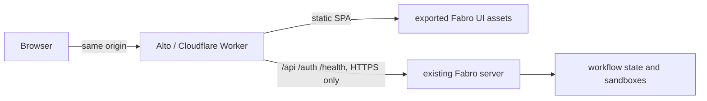
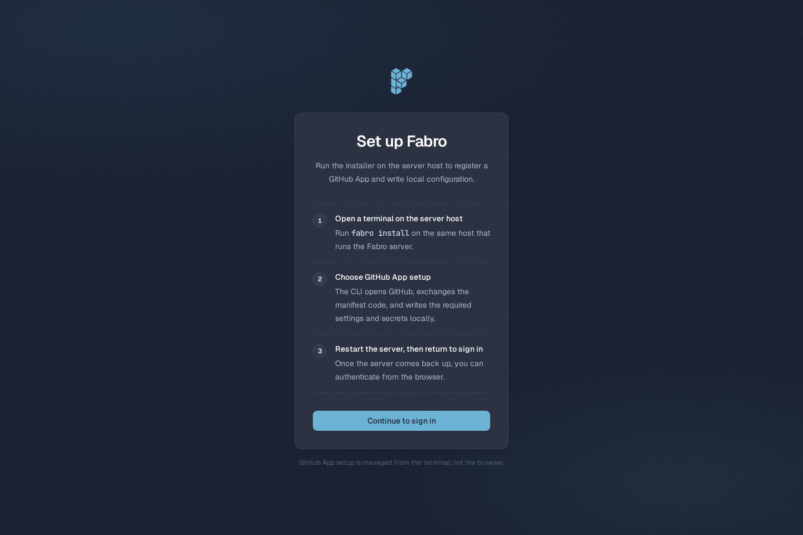

# Fabro Alto UI Worker prototype

This optional deployment serves the existing Fabro SPA from an Alto-managed
Cloudflare Worker. It keeps the existing Fabro server as the workflow executor,
state store, and authorization authority.





The screenshot is genuine browser evidence of the exported SPA's `/setup` route
served from a local static fixture at `127.0.0.1`; it intentionally has no
backend, login, user data, or credentials. It demonstrates asset packaging and
SPA fallback only, not an authenticated Alto deployment.

The Worker forwards only `/api`, `/api/*`, `/auth`, `/auth/*`, and `/health`.
It reads the fixed `FABRO_BACKEND_ORIGIN` secret at runtime, rejects any
non-HTTPS or private/loopback origin, and never accepts a browser-selected
upstream. Browser cookies, methods, queries, request bodies, redirects, and
streaming responses (including SSE) are preserved. It removes Alto and
Cloudflare identity/platform headers before forwarding. API and auth responses
are left uncached; hashed UI assets are immutable while the HTML entry point and
`build-id.json` revalidate.

## Terminal WebSocket passthrough

This is native Worker hosting, not Alto external-origin routing. The Worker
passes the browser's standard WebSocket upgrade through the fixed backend origin,
preserving `Connection`, `Upgrade`, and `Sec-WebSocket-*` headers while still
removing Alto and Cloudflare identity/platform headers. It returns the native
upstream response without re-wrapping it, because re-wrapping would discard the
Worker runtime's WebSocket endpoint.

The published `@workos/alto` 0.26.0 wrapper's `altoFetch` implementation
verifies identity and then calls the app handler without rejecting or changing
upgrade requests. The native Cloudflare Worker bundle therefore has a normal
upgrade path. This checkout cannot exercise a live Alto ingress/backend pair,
so the host must include an authenticated terminal smoke test in its private-app
verification rather than treating the former external-origin limitation as
evidence against native Worker upgrades.

## Package the existing UI

The Worker intentionally does not rebuild the React application. Build it with
the repository's pinned Bun workflow, then copy the resulting static artifact:

```sh
bun install --frozen-lockfile
cd apps/fabro-web && bun run build
cd ../../deploy/alto-fabro-ui
npm ci --ignore-scripts
npm run export-ui
npm test
npm run build
```

`export-ui` copies `apps/fabro-web/dist` to `public/` and records the source
revision and UI build id in `public/.fabro-ui-provenance.json`. Those exported
assets are committed with this package so managed builds can run `npm ci
--ignore-scripts`, `npm run build`, and `wrangler deploy --dry-run` without Bun.
The build validates Cloudflare's prototype budget: at most 2,000 files, 10 MiB
per file, and 32 MiB total.

## Alto configuration and review checklist

`wrangler.jsonc` purposely contains only Worker code/assets settings. Do not add
an account ID, deployment token, route, backend URL, or environment-secret
binding to it.

Before a host deploys this:

1. Create the private Alto application and restrict access to Mae.
2. Declare `FABRO_BACKEND_ORIGIN` as a production secret in `alto.json`, with
   no environment binding, then set it to the fixed public HTTPS Fabro origin.
3. Configure Alto egress as deny-by-default and approve exactly that backend
   hostname. Do not use a wildcard, a private address, or a user-provided URL.
4. Register the browser's canonical Worker HTTPS origin with the Fabro server's
   allowed-origin/session-cookie settings before sending users there. Do not
   expose the backend directly or use a shared backend bearer token.
5. Verify login, an authenticated API request, an SSE run stream, redirect and
   multiple-cookie behavior, and an authenticated browser terminal session.

The exact `alto.json` declaration spelling must be filled from the host's
current private Alto CLI/schema: that schema was not available to this checkout,
and inventing a manifest shape would make this package less deployable. The
runtime secret API is verified against published `@workos/alto` 0.26.0:
`ctx.alto.governance.secrets.get("FABRO_BACKEND_ORIGIN")`.

For a release-candidate bundle only, after the host has configured the private
app, run:

```sh
npm run deploy:dry-run
```

Do not run a live Wrangler deploy from this checkout.

## Rollback

Remove the Worker route or restore the preceding Alto application release. The
Fabro server and its state are unchanged, so clients can return to its existing
UI origin immediately. Revoke the Alto secret/egress approval if the Worker must
be disabled completely.
