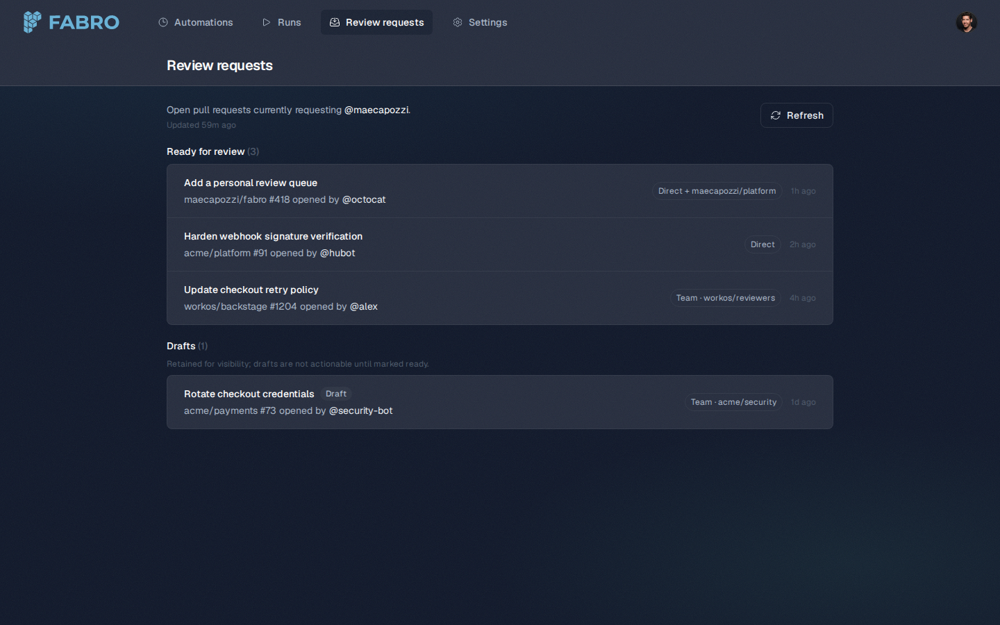
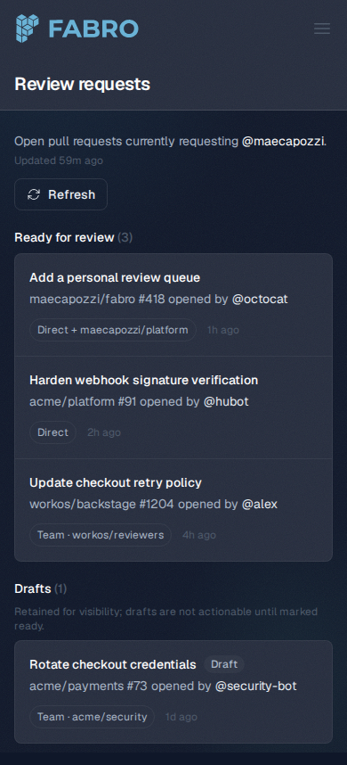
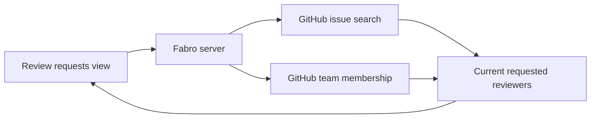

Fabro now has a native personal review queue. It searches every repository
visible to the configured GitHub connection, verifies each candidate against
the pull request's live open/merged/draft state and current requested
reviewers, and keeps draft and partial coverage states explicit. The queue is
independent of Fabro runs, so pull requests created elsewhere are included.

Desktop:



Mobile:





Team requests are complete only when the configured credential can establish
the signed-in user's memberships. GitHub App installation tokens cannot do
that on their own, so the UI reports limited team coverage instead of implying
that the queue is exhaustive.

## Capture provenance

These images are browser screenshots of the production-built React route, not
HTML or SVG mockups. The checked-in capture script serves
`apps/fabro-web/dist`, supplies deterministic responses for
`/api/v1/auth/me` and `/api/v1/review-requests`, opens the actual
`/review-requests` route in Chromium, waits for its rendered heading, and
captures desktop and mobile viewports.

From the repository root:

```sh
(cd apps/fabro-web && bun run build)
PLAYWRIGHT_BROWSERS_PATH=/opt/playwright \
  /opt/fabro-venv/bin/python docs/internal/pr-assets/capture_review_requests.py
```
